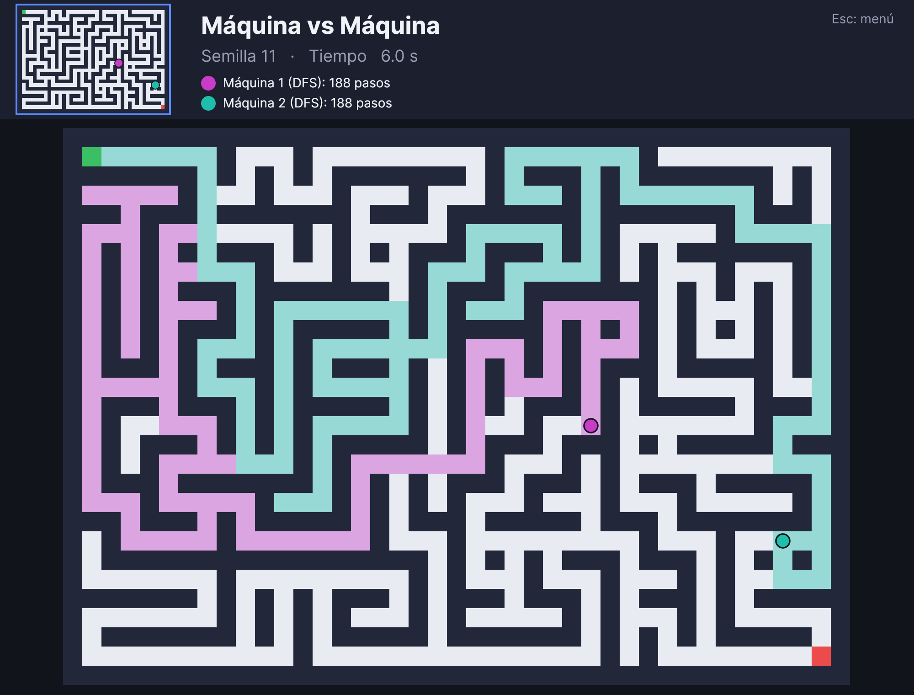

# Laberinto Inteligente

Proyecto de Inteligencia Artificial (Ingeniería en Computación Inteligente, 3er semestre, UAA).
Juego de laberinto en **C# con Avalonia** que genera un mapa distinto en cada partida y donde la
máquina lo resuelve con **búsqueda en profundidad (DFS)**.



## Requisitos y ejecución

Requiere el [SDK de .NET 8](https://dotnet.microsoft.com/download/dotnet/8.0). Corre en Windows, Linux y macOS.

```bash
dotnet run --project src/LaberintoInteligente.Interfaz
```

En Visual Studio o Rider: abrir `LaberintoInteligente.sln` y ejecutar el proyecto `LaberintoInteligente.Interfaz`.

Opciones de arranque (después de `--` si se usa `dotnet run`):

| Opción | Efecto |
|---|---|
| `--modo 1\|2\|3` | Salta el menú e inicia esa modalidad |
| `--semilla N` | La primera partida usa el laberinto de la semilla N (la semilla se muestra en pantalla) |
| `--velocidad MS` | Milisegundos entre pasos de los agentes (por defecto 30; súbelo para hacerlos más lentos) |

Ejemplo: `dotnet run --project src/LaberintoInteligente.Interfaz -- --modo 2 --semilla 42`

## Modalidades y controles

1. **Máquina vs Máquina**: dos agentes con DFS compiten por la salida.
2. **Máquina vs Usuario**: tú (flechas) contra un agente.
3. **Usuario vs Usuario**: Usuario 1 con las flechas y Usuario 2 con `W A S D`.

En el menú: teclas `1`, `2`, `3` o clic. Durante la partida `Esc` regresa al menú. En la pantalla de
resultados, `Enter` vuelve al menú y `R` inicia otra partida de la misma modalidad con un mapa nuevo.

## Estructura

```
src/LaberintoInteligente.Core/        lógica, sin dependencias de interfaz
    Laberinto.cs        representación, generación aleatoria, BFS y validación
    BusquedaDfs.cs      DFS paso a paso (pila explícita + conjunto de visitadas)
    Participantes.cs    Jugador (teclado, colisiones) y Agente (avanza con la DFS)
    Juego.cs            máquina de estados: Menú → Jugando → Resultado
src/LaberintoInteligente.Interfaz/    aplicación Avalonia
    VentanaPrincipal.cs teclado, mouse y bucle del juego (DispatcherTimer, ~60 fps)
    LienzoJuego.cs      dibujo de menú, laberinto, minimapa, barra de información y resultados
tests/LaberintoInteligente.Tests/     21 pruebas xUnit
tools/LaberintoInteligente.Capturas/  simula partidas sin ventana y genera docs/capturas/*.png
```

## Cómo funciona

**Representación.** El laberinto es una matriz `int[,]` (`1` muro, `0` camino) de 29 × 41 casillas
(14 × 20 celdas), indexada como `Matriz[y, x]`. La misma matriz sirve para dibujar el mapa y el
minimapa, para las colisiones y para la búsqueda.

**Generación (`Generador.Generar`).** Cada partida usa una semilla nueva. Un DFS iterativo con
retroceso talla los pasillos desde la esquina superior izquierda, lo que garantiza que todo el
laberinto queda conectado y por tanto es resoluble. Después se abre un 8 % de los muros entre
pasillos para crear rutas alternativas (ciclos). La validación posterior usa BFS, independiente del
DFS del agente.

**Agente (`BusquedaDfs`).** Cada llamada a `Paso()` profundiza hacia un vecino no visitado o, si no
hay ninguno, retrocede desapilando. Usa una `Stack<Posicion>` con el camino actual y un
`HashSet<Posicion>` de casillas visitadas para no repetir. Al llegar a la meta, la pila es la ruta
solución. El `Agente` da un paso cada vez que pasa su intervalo, por eso se ve cómo explora y
retrocede en lugar de saltar directo a la solución. El rastro de colores marca lo que exploró cada agente.

**Por qué DFS no siempre gana.** DFS no garantiza la ruta más corta. En un laberinto sin ciclos solo
hay una ruta y coincide con la óptima, pero con ciclos DFS no dio la ruta más corta en 98 de 100
mapas. En promedio necesita ~508 pasos frente a ~105 de la ruta óptima. Cada agente baraja el orden de
sus vecinos con su propia semilla, así que dos agentes nunca exploran igual (100 de 100 mapas).

## Pruebas

```bash
dotnet test                                              # 21 pruebas: generador, DFS y juego
dotnet run --project tools/LaberintoInteligente.Capturas # simula las 3 modalidades y guarda capturas
```

## Equipo

Ian Christopher Hernández Mera y Brandon.
